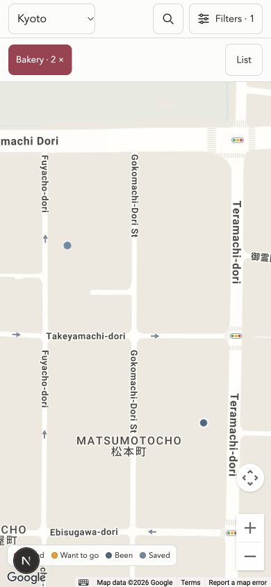

# Backend and UI audit fixes — 22 October 2026

## Outcome in plain words

**The local view change is complete. Choose a specific category to see its results immediately.**

On mobile, choosing Bakery closes Filters and keeps the current view.

| Current view | Result after choosing Bakery | View button |
|---|---|---|
| Map | Bakery pins appear. | List |
| List | Bakery entries appear. | Map |

Switching views keeps the category and your other filters selected. There is no extra Show or confirmation step.

Broad groups, such as Food, stay open so you can choose a more specific category. Desktop still shows Map and List together.

**ELI5:** Choose which places you want. The app shows them. Use the view button to see the same places another way.

The changes are saved locally. They are not published to a live site. Your saved places are unchanged. The earlier admin and save protections remain in place.

The latest view change passed 25 focused tests, type checking, and the production build. The earlier full suite passed 185 tests before this refinement.

## Next steps in plain words

The preview server is stopped. Start it before opening the app.

1. **Start the app.** In the project folder, run `pnpm dev`.
2. **Open the local address shown in the terminal.** Reload any older copy already open in your browser.
3. **In Map, choose Bakery.** Check that bakery pins appear and the view button says List.
4. **Select List.** Check that Bakery stays selected and the view button changes to Map.
5. **In List, choose another specific category.** Check that the list updates without switching to Map.

**ELI5:** Start the app, choose places, then switch views. You should see the same selected places in both views.

Before publishing, complete the phone and hosting checks under Remaining limits and release checks. No live release has been performed.

## Changes completed

The labels below refer to the [original audit](2026-10-22-backend-ui-ux.md).

| Audit item | Completed behavior | Verification |
|---|---|---|
| B1: Public admin catalog | `/admin` renders an empty shell. Its authenticated catalog endpoint sends `private, no-store`. Workflows stay hidden until data loads. | Production HTML and React server responses contained no catalog IDs. Anonymous and wrong-password catalog requests returned 401. A test password returned 712 records. |
| B2: Changed review candidates | Verify and Reject require a stamp covering the Sheet, headers, row position, and full row values. Changed rows return 409 without writing. | Mocked regressions cover both decisions, every source field, moved rows, changed headers, and a different Sheet. |
| U1: Extra Show button | A specific category updates the current view and closes mobile filters. The toolbar and footer offer only the opposite view. | Browser checks at 390 × 844 and 320 × 568, including keyboard selection and More. Focus reached the current results region. |
| U2: Missing admin errors | General failures appear in a visible alert. Password input and drafts are retained. | Wrong test password showed the alert and retained the masked input. Unauthenticated workflows no longer display misleading empty results. |
| B3: Unrated values | Category-only edits keep the original rating, including `null`. An explicit status change applies the chosen state. | Regression covers null, false, and true. The original floating inspector also preserves null until the user changes it. |
| B4: Older local editors | Both local editors send their original record stamp. Inline editing sends only category and status fields. Stale records and atomic write conflicts return 409. | Regressions verify no stale write, preserved unrelated fields, fresh success stamps, and failed disk writes remaining failures. |
| U3: List depends on Map | List expands the shared details card. Show on map is separate. Missing scripts, missing keys, and Maps authentication failures offer View list. | Browser checks verified inline address and Maps link, selected-place transfer, and recovery from a real referrer error. |
| U4: Cancelled Nearby request | Cancel, Reset, manual city changes, replaced requests, and unmounting invalidate old callbacks. | Focused success/error callback tests. Physical location permission was not requested during browser testing. |
| U5: Hidden count announcement | One live count remains outside the hidden toolbar. | Browser DOM inspection found one count status with visible styles while filters were open. Spoken screen-reader output remains unverified. |
| B5: Invalid field types | Stored records check strings, notes, coordinates, enums, ratings, and URL syntax before use or writing. Relevant edit routes reject malformed JSON and field values. | All 712 current records passed. Regressions reject malformed required and optional values and unsafe URL schemes. |
| Retained resolver API | A new Maps URL or changed location clears old candidate evidence. A new link takes priority over an old address cache. New candidates require review. | Injected provider tests cover changed sources, failed lookups, corrected addresses, and preservation of closed status. |
| Retained staging API | New drafts receive unique IDs. Exact create retries reuse the existing draft. An explicit ID updates that draft. Published ID collisions are blocked. | Regressions cover long-name collisions, retries, explicit updates, and published collisions. |
| Retained verification API | Explicit `loved: null` clears the value instead of retaining the old Loved flag. | Regression verifies the stored result. |
| Area aliases | Kyoto ward pairs share one filter value. Other cities and original stored labels stay unchanged. | Alias URL and matching tests. Nakagyo and Nakagyo Ward now produce one area choice. |
| Browser Back | Deliberate city, filter, and view choices add history entries. Search typing updates the current entry. | Browser Back restored the previous Map choice and filters. |
| Deferred category discovery | Other contains places without a named group. Original specialty names remain distinct. | Group coverage and specialty regressions. No type labels were renamed. |

Incomplete staging remains supported. A Review draft can keep one or both coordinates as `null`. Verified drafts require coordinates. Publishing an incomplete draft stops before published-data access.

Publishing also retains staged notes. This closes a related data-preservation gap found during implementation.

## Design and compatibility notes

- The application still uses its existing Next.js structure, data file, shared detail card, and map library.
- No database, authentication package, catalog migration, or new runtime dependency was added.
- Public pages retain their field allowlist. Their edit stamps contain a hash, not internal record fields.
- Record stamps are calculated from the full saved record and exclude the transient stamp itself.
- Candidate stamps are checked for Reject as well as Verify.
- Admin Publish and Sync retain their existing Preview and Apply steps.
- Local editing still requires localhost and the existing admin authorization rules.
- Stored map links accept valid HTTP(S) syntax without embedded credentials. Provider lookup retains its stricter HTTPS and host restrictions.
- Previous resolver evidence remains recoverable in the existing atomic-write backup. Changed links do not reopen a closed record.
- The Google Maps authentication callback preserves other consumers and restores their handler after cleanup.

Older local editor clients need a reload. Older candidate-decision clients must refresh to obtain a stamp. The API intentionally rejects requests without the required version information.

## Validation

| Check | Result |
|---|---|
| `pnpm test` | 185 tests passed; zero failures or skips. |
| `pnpm typecheck` | Passed. |
| `pnpm build` | Optimized production build passed, including TypeScript checking. |
| `git diff --check` | Passed. |
| Catalog and type decisions | No changes. Both match the starting Git version. |
| Public browser checks | Desktop, 390 × 844, and 320 × 568; direct views, inline details, focus transfer, Back, zero results, and exposed live count. |
| Map success and failure | Normal map and selected card worked at localhost. A denied 127.0.0.1 referrer showed the app's plain failure and View list action. |
| Admin browser check | Wrong test password showed a visible error. Masked input remained present. |
| Production admin requests | HTML/server responses omitted catalog IDs. Anonymous and wrong-password requests returned 401. Authorized catalog reads returned 200 with `private, no-store`. |
| Independent review | Separate agents reviewed admin changes and data changes. Two earlier review findings were fixed and covered by regressions. |

The 31 additional tests cover admin access and review decisions, edit versions and validation, area/group behavior, location cancellation, Maps authentication, and resolver source changes.

Tests used temporary or in-memory write targets and mocked provider responses. Real catalog records, Google Sheets, and credentials were not changed. Normal public map inspection loaded Google Maps.

The local production check used a temporary test password and a loopback-only listener. This does not establish the state of a hosted deployment.

## Remaining limits and release checks

- Google Sheets does not provide a transaction for this workflow. An external writer can still change a row after the final read and before the write.
- The allowed Maps referrer configuration was not changed. The current localhost origin worked; the 127.0.0.1 origin was denied. Check the actual deployment origin before release.
- Confirm that the deployment retains its writable catalog and that all writers share the same file. Hosting was not inspected.
- Physical-phone operation, spoken screen-reader feedback, full keyboard traversal, 200% text enlargement, and 400% browser zoom remain unverified.
- Nearby cancellation is covered by callback tests. No real location permission was requested.

No production deployment or live admin write was performed.

## Browser evidence

After choosing Bakery in Map, the two matching pins appear and the button offers List:

- [Bakery in List with one Map action](2026-10-22/bakery-list-single-switch.jpg).

- [List details without Map](2026-10-22/mobile-list-details-updated.jpg).
- [Map failure recovery](2026-10-22/map-failure-updated.jpg).
- [Visible admin error](2026-10-22/admin-error-updated.jpg).
- [Desktop panes](2026-10-22/desktop-updated.jpg).

## Follow-up: automatic category results and one view switch

The user's later clarification replaces the original two-button footer design.

| Current view | Category selection | Available switch |
|---|---|---|
| Map | Bakery pins appear immediately. | List |
| List | Bakery entries appear immediately. | Map |

On mobile, selecting a specific category closes filters and focuses the current results. The searchable More menu does the same. Broad groups stay open for specialty selection. Search and other refinements keep their existing live behavior. Desktop continues to show both panes.

Switching views keeps the selected category and other filters. Dialog cleanup finishes before results receive focus, so closing More cannot send focus back into hidden filters.

Follow-up validation:

- Type checking passed.
- The production build passed, including its TypeScript check.
- All 25 focused explorer, Field Guide, and preview tests passed.
- Browser checks confirmed both directions, the More menu, preserved Bakery selection, and current-view focus.
- A 320-pixel check confirmed one opposite-view footer action and keyboard selection. Desktop retained both panes.
- An independent source review found no material issue.
- The catalog and backend were unchanged by this refinement.

The 185-test result above belongs to the earlier complete audit implementation. These checks cover the later UI refinement. The temporary preview server was used only for inspection.

## Data fingerprints

These identify the unchanged inputs used for verification.

| File | SHA-256 |
|---|---|
| `src/data/places.json` | `91be1eedc3d1923ec6bb520a33c8103fb7ee1b3895afbb5d2cf3dd3e3ce9f2f7` |
| `src/data/place-type-decisions.json` | `c0f43fe1fb36003183578bee2a50ad66cbff537677231aa37bf5b4dca71cff7a` |
