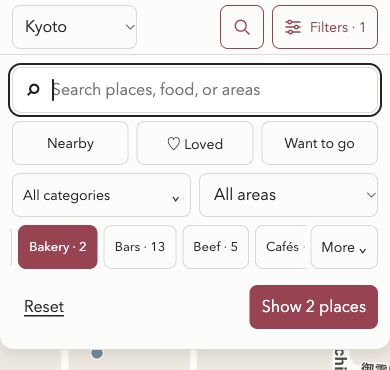

# Backend and UI/UX audit — 22 October 2026

> This is the original audit. The recommendations were implemented later in this
> chat. See the [implementation record](2026-10-22-audit-fixes.md) for current behavior,
> validation, and remaining release checks.

## Outcome in plain words

**Replace “Show X places” with direct Map and List actions on mobile.**

The app already changes the results when someone selects a filter. “Show X places” only closes the filter panel. The panel hides Map and List, so opening List requires another tap.

Think of the filters as choosing toys from a box. The app has already chosen the toys. The extra button only removes the lid.

The backend has useful safeguards. Its main gaps concern information that changes after someone reviews it. One deployment condition also exposes internal records through the admin page.

This audit changed documentation only. It did not fix the application or change place records.

## Recommended next steps

1. **Protect the admin page before enabling public access.** Authenticate before sending internal records to a browser.
2. **Show admin errors beside the failed action.** Keep the entered information so the user can correct it.
3. **Replace the mobile footer with a count, Map, and List.** Each view action must close the panel and open that view.
4. **Check that reviewed information has not changed before saving.** Apply this check to candidate approval and local editing.
5. **Preserve ratings during unrelated edits.** Changing a category must not change an “unrated” value.
6. **Make List useful without a working map.** Let users read details and open Google Maps directly.
7. **Fix cancelled location requests and hidden result announcements.** Then review area aliases and deferred category groups.

These are recommended implementation steps. No implementation or deployment was requested or performed.

## Recommended filter flow

| Stage | Current behavior | Recommended behavior |
|---|---|---|
| Open Filters | Filters cover the map and hide Map/List. | Keep the filter panel and display its view actions. |
| Select a category or specialty | Results change behind the panel. | Keep this immediate update. Display the new count. |
| Open Map | Select “Show X places” when Map is active. | Select **Map**. Close the panel and open Map. |
| Open List | Select “Show X places,” then **List**. | Select **List**. Close the panel and open List. |
| Add another filter | The panel stays open. | Keep the panel open while the user refines results. |
| Use desktop | Map and List appear together. | Keep both panes. Avoid redundant view actions. |

Use a footer such as **2 places · Map · List**. The count is information. Map and List are actions.

Do not add another screen that asks which view to open. That would keep the extra step. Do not close the panel after a broad group selection, because users may still want a specialty or area.

Preserve the selected city, filters, and current place when changing views. Reset a selected place only when a filter excludes it. Escape should close the panel and retain the live filter changes.

**Acceptance checks:**

- From an open filter panel, a selected specialty needs one further tap to reach either view.
- Map and List remain available when there are zero results.
- Changing views retains the same result count and filters.
- Keyboard focus moves to the chosen results region after the panel closes.
- One accessible status message announces the new count without moving focus.
- Existing category links, city memory, and desktop panes still work.

Current mobile panel after selecting Bakery:

## Scope and evidence

- Reviewed the working tree at commit `1f97eb7` (`bigger dots`). It had no tracked changes at the start.
- Reviewed the public guide, filter logic, local editor, admin interface, API routes, data pipeline, provider resolution, and JSON storage.
- Inspected the running guide at desktop size, 390 × 844, and 320 × 568 CSS pixels.
- Interacted with category selection, Map/List, list selection, place details, search, zero results, and Escape dismissal.
- Used independent agents for backend review, UI source review, and data checks. Their findings were consolidated here.
- Reproduced four backend defects with temporary data and mocked providers. The real catalog was not used as a write target.
- Did not read real credentials or environment values. Did not perform admin writes or direct live provider tests.
- The normal guide loaded Google Maps during browser inspection. Initial tiles were delayed; streets appeared during the later detail check.

**Priority:** P1 means fix before the affected public deployment. P2 means a concrete correctness or usability improvement. P3 means a later refinement.

Source links below use the local workspace paths. Line numbers describe the audited version.

## Main findings

### B1 — P1, conditional: The enabled admin page sends internal records before authentication

**Effect:** A visitor can receive internal verification information without entering the admin password.

In production, `/admin` checks `ENABLE_ADMIN`. When enabled, it passes the complete catalog to a client component. The API password checks do not protect this page response.

This finding applies if the enabled page is reachable by untrusted visitors. Deployment settings and external access were not inspected. This audit does not claim that a live site currently exposes this information.

**Recommendation:** Render an empty admin shell, then request records through an authenticated endpoint. An authenticated page session is another valid approach.

**Check after fixing:** An unauthenticated page request must contain no internal records. Authenticated access must still load the admin workflows.

Evidence: [admin page](/Users/tomurho/projects/travel%20map/app/admin/page.tsx:8), [client properties](/Users/tomurho/projects/travel%20map/app/admin/page.tsx:25), [public field allowlist](/Users/tomurho/projects/travel%20map/src/components/field-guide/field-guide-page.tsx:7).

### B2 — P2: Verify can approve a different venue from the one displayed

**Effect:** A user can inspect venue A and accidentally approve venue B.

The server rereads the Review sheet, but matches the submitted ID and row number only. It does not compare the venue details displayed earlier.

A mocked reproduction changed the venue under the same ID and row. Verify approved the changed venue and generated four cell updates.

**Recommendation:** Give each displayed candidate a version stamp derived from its reviewed fields. Reject Verify or Reject if that stamp changes. Ask the user to refresh and review again.

**Check after fixing:** Change a candidate name, address, coordinates, or Maps link after loading the queue. The old decision must fail without writing.

A version stamp detects changes before the server's final read. It does not make Google Sheets writes transactional. External changes after that read remain a separate concurrency limit.

Evidence: [candidate match](/Users/tomurho/projects/travel%20map/src/lib/place-sheet-pipeline.ts:2121), [decision request](/Users/tomurho/projects/travel%20map/app/api/admin/place-pipeline/review-candidates/route.ts:46).

### U1 — P2: “Show X places” adds a mobile step

**Effect:** Users must dismiss filters before they can choose List.

The browser confirmed that selecting Bakery changed the URL, markers, and count before pressing “Show 2 places.” The button only closed the panel.

**Recommendation:** Apply the direct Map/List flow above. Keep the current live filtering behavior.

Evidence: [immediate filter update](/Users/tomurho/projects/travel%20map/src/components/field-guide/field-guide-app.tsx:142), [footer action](/Users/tomurho/projects/travel%20map/src/components/field-guide/field-guide-app.tsx:271), [hidden toolbar](/Users/tomurho/projects/travel%20map/src/components/field-guide/field-guide-explorer.module.css:137).

### U2 — P2: Several admin failures have no visible message

**Effect:** A failed action can appear to do nothing. Users do not know what to correct.

The admin component stores a general `error` value. Its final layout never renders that value. Missing Sheet IDs, invalid API limits, and screenshot failures use this error state.

The candidate queue has a separate displayed error. That does not display the general errors described here.

**Recommendation:** Show each error beside its action with `role="alert"`. Keep entered values. A general alert below the header is a useful first repair.

**Check after fixing:** Submit an empty Sheet ID and simulate a failed screenshot extraction. Each failure must show a useful message. The entered information must remain available.

Evidence: [error state](/Users/tomurho/projects/travel%20map/src/components/admin-workflow.tsx:514), [missing Sheet ID](/Users/tomurho/projects/travel%20map/src/components/admin-workflow.tsx:1432), [extraction failure](/Users/tomurho/projects/travel%20map/src/components/admin-workflow.tsx:1678), [rendered layout](/Users/tomurho/projects/travel%20map/src/components/admin-workflow.tsx:2866).

### B3 — P2: A category edit can change an unrated place

**Effect:** Changing only a category can also change the stored rating.

The current catalog contains 55 records with `status: "been"` and `loved: null`. The editor displays these as Been. Saving converts the rating to `false`, even when status was untouched.

The original interface treats `null` as Unrated. Therefore, `null` and `false` have different meanings.

**Recommendation:** Preserve the original rating unless the user changes status. If the product no longer needs an unrated state, approve and document a separate migration.

**Check after fixing:** Edit only the category of a Been/Unrated record. Its rating must remain `null`.

Evidence: [initial state](/Users/tomurho/projects/travel%20map/src/components/field-guide/field-guide-place-editor.tsx:17), [saved state mapping](/Users/tomurho/projects/travel%20map/src/components/field-guide/field-guide-place-editor.tsx:24), [save body](/Users/tomurho/projects/travel%20map/src/components/field-guide/field-guide-place-editor.tsx:83), [Unrated filter](/Users/tomurho/projects/travel%20map/src/lib/filtering.ts:90).

### B4 — P2: An older editor can replace newer changes

**Effect:** A second tab can overwrite changes saved by the first tab.

The local editor sends its stored name and district, although its controls edit category and status. The server accepts these older values without checking which record version the browser opened.

The existing file hash protects the server's read-to-write interval. It does not protect the longer interval while the user edits.

**Recommendation:** Send only editable fields. Require the original record version for a save. Return a conflict message when the record changed.

**Check after fixing:** Open one place in two tabs. After the first save, the older save must require a refresh. It must not replace unrelated fields.

Evidence: [request fields](/Users/tomurho/projects/travel%20map/src/components/field-guide/field-guide-place-editor.tsx:83), [server read](/Users/tomurho/projects/travel%20map/src/lib/admin-staging.ts:683), [replacement fields](/Users/tomurho/projects/travel%20map/src/lib/admin-staging.ts:734), [file hash check](/Users/tomurho/projects/travel%20map/src/lib/admin-staging.ts:746).

### U3 — P2: List depends on Map for complete details

**Effect:** Users cannot stay in List to read an address, notes, or the Google Maps action.

The browser confirmed that selecting a list entry switches to Map. List cards contain a name, type, and area. The complete detail card appears in the map pane.

The map's load-failure screens also provide developer instructions without a direct recovery action.

**Recommendation:** Open the shared detail card within List. Add a separate **Show on map** action. Give map failures a **View list** action and a plain explanation.

This extends the previous intentional map-first behavior. It is a product improvement, rather than a regression claim.

**Check after fixing:** With the map unavailable, a user must still read details and open the saved Google Maps link.

Evidence: [list selection](/Users/tomurho/projects/travel%20map/src/components/field-guide/field-guide-app.tsx:173), [list content](/Users/tomurho/projects/travel%20map/src/components/field-guide/field-guide-place-card.tsx:45), [map failure states](/Users/tomurho/projects/travel%20map/src/components/map-view.tsx:430).

### U4 — P2: A cancelled Nearby request can turn itself back on

**Effect:** The app can change the user's city after they select another city or reset filters.

Reset turns Nearby off. However, an outstanding location callback always turns it on again. That callback can also select a nearby city.

**Recommendation:** Track the active location request. Ignore results from cancelled or replaced requests, including their city changes.

**Check after fixing:** Start Nearby, then reset or choose a city before location returns. A late success must preserve the latest choice.

Evidence: [reset](/Users/tomurho/projects/travel%20map/src/components/field-guide/field-guide-app.tsx:133), [manual city change](/Users/tomurho/projects/travel%20map/src/components/field-guide/field-guide-app.tsx:147), [unconditional callback](/Users/tomurho/projects/travel%20map/src/components/field-guide/field-guide-app.tsx:299), [location completion](/Users/tomurho/projects/travel%20map/src/components/map-view.tsx:385).

### U5 — P2: Result announcements disappear while mobile filters are open

**Effect:** Assistive technology loses the intended live result count during filtering.

Browser inspection found both count status elements under `visibility: hidden` while the panel was open. One was also `display: none`. The changing footer button has no live status role.

**Recommendation:** Keep one result status outside the hidden toolbar, or put it inside the filter panel. Avoid duplicate announcements.

This is a confirmed DOM and style issue. Screen-reader speech was not tested. W3C describes result counts and errors as status updates that assistive technology should receive. See [Status Messages](https://www.w3.org/WAI/WCAG22/Understanding/status-messages.html).

Evidence: [count elements](/Users/tomurho/projects/travel%20map/src/components/field-guide/field-guide-app.tsx:277), [toolbar visibility](/Users/tomurho/projects/travel%20map/src/components/field-guide/field-guide-explorer.module.css:138).

### B5 — P2 hardening: The JSON validator accepts field types that can crash the UI

**Effect:** A malformed data update can pass validation and then break place details.

Read-only checks showed that `address: 123` and `notes: [123]` pass dataset validation. Rendering later calls `.trim()` on those values. The current catalog passed inspection; this is a boundary weakness.

**Recommendation:** Check actual field types before accepting JSON. Validate optional notes and URLs as well as required fields. Return a specific record and field in each error.

**Check after fixing:** Numeric addresses and non-string notes must fail before writing or serving the catalog. Include malformed API bodies in the same review.

Evidence: [incomplete field checks](/Users/tomurho/projects/travel%20map/src/lib/places-json-store.ts:63), [notes trimming](/Users/tomurho/projects/travel%20map/src/lib/place.ts:146), [address trimming](/Users/tomurho/projects/travel%20map/src/components/field-guide/field-guide-place-card.tsx:115).

## Additional improvements

| Priority and scope | Finding | Recommendation and evidence |
|---|---|---|
| P2, retained resolver API | A changed Maps URL can retain old coordinates, Place ID, and Verified status. A temporary fixture reproduced this mismatch. | Reuse evidence only when its source and venue inputs match. Otherwise resolve again or require review. [Reuse branch](/Users/tomurho/projects/travel%20map/src/lib/google-place-admin-resolver.ts:763), [write](/Users/tomurho/projects/travel%20map/src/lib/google-place-admin-resolver.ts:932). |
| P2, retained staging API | Two long venue descriptions can produce the same truncated ID. Staging the second silently replaces the first. A fixture left one record from two distinct inputs. | Give new drafts unique IDs. Require an explicit update action for replacement. [80-character truncation](/Users/tomurho/projects/travel%20map/src/lib/admin-staging.ts:127), [ID creation](/Users/tomurho/projects/travel%20map/src/lib/admin-staging.ts:286), [replacement](/Users/tomurho/projects/travel%20map/src/lib/admin-staging.ts:325). |
| P2, retained verification API | Saving `loved: null` retains the previous Loved value. A fixture requested `null` and stored `true`. | Treat an omitted value and explicit `null` differently. Check other clearable fields at the same time. [Null fallback](/Users/tomurho/projects/travel%20map/src/lib/admin-staging.ts:782). |
| P2, area filtering | Kyoto has separate Nakagyo and Nakagyo Ward choices. They contain 8 and 79 records. Exact matching splits these area labels. | Review aliases within each city. Use one filter value for approved equivalents and keep original address text. [Area options](/Users/tomurho/projects/travel%20map/src/components/field-guide/field-guide-app.tsx:116), [exact match](/Users/tomurho/projects/travel%20map/src/lib/field-guide-explorer.ts:62). |
| P3, navigation | Every filter and view change replaces the browser history entry. Back cannot undo deliberate city or category navigation. | Add history entries for deliberate navigation. Continue replacing entries while typing. [Navigation](/Users/tomurho/projects/travel%20map/src/components/field-guide/field-guide-app.tsx:139). |
| P3, category discovery | 28 public places belong only to All categories. These include nine tea shops. Their type decisions were deliberately deferred. | Keep exact specialty labels. Add an explicit Other group, or approve group assignments without renaming types. [Memberships](/Users/tomurho/projects/travel%20map/src/lib/field-guide-explorer.ts:10), [matching](/Users/tomurho/projects/travel%20map/src/lib/field-guide-explorer.ts:34). |

The current admin layout displays Screenshot intake and the Sheets pipeline. The old staging and production-review sections are no longer rendered. Their routes remain callable, so their backend defects still matter. Fix or retire those routes according to actual use.

## What should stay

- Keep the simple Next.js application and existing shared components. This audit found no reason for a broad rewrite.
- Keep the public field allowlist and removal of Closed/Moved records before sending data to the public guide.
- Keep shared API authorization. Production API requests fail closed when no password is configured.
- Keep catalog locks, backups, atomic replacement, and file-version checks.
- Keep Preview and Apply for Publish and Sync. These actions have real write consequences and already check preview versions.
- Keep labelled controls, visible focus styles, native category dialogs, Escape handling, and large mobile controls.
- Keep list batching and marker clustering. No measured performance problem justified replacing them.

Preview/Apply serves a different purpose from the public “Show places” button. The admin confirmation protects data writes. The public button only dismisses a panel.

## Data and operational notes

The public catalog contains **712 places across 11 cities**. Its projected JSON is about **355 KiB before compression**. Ninety-nine places have no district value.

All 702 stored Maps URLs used HTTPS Google hosts. Ten records use generated fallback URLs. This check describes current data; it does not replace validation of future inputs.

Loading all cities is acceptable at this size unless measurement shows otherwise. Measure mobile transfer size and render time before adding city-specific loading or new infrastructure.

Before enabling hosted editing, confirm that the hosting disk retains changes and that writers share the same catalog. This audit did not verify the hosting environment.

## Validation and limits

| Check | Result |
|---|---|
| `npm test` | 154 passed; zero failed or skipped. |
| `npm run typecheck` | Passed. |
| `pnpm build` | Production build passed. |
| `git diff --check` | Passed after documentation work. |
| Browser: desktop and two mobile widths | Filter flow, view switching, details, search, zero results, and Escape checked. |
| Backend temporary fixtures | Reproduced stale approval, changed-URL evidence reuse, staging ID collision, and null-Loved retention. |
| Data boundary probes | Confirmed invalid address and notes types can pass validation. |

Passing tests describe the existing test coverage. They do not clear the findings above.

The backend reproduction harness was `/private/tmp/travel-map-backend-audit.mts`. It used temporary files, synthetic credentials, and mocked Google Sheets responses. It removed its fixture data afterward.

No deployment, hosted authentication flow, live admin write, or physical phone was tested. Full keyboard traversal, screen-reader speech, 200% text enlargement, and 400% browser zoom remain unverified. A 320-pixel viewport check is not a complete zoom audit.

W3C's [Reflow guidance](https://www.w3.org/WAI/WCAG22/Understanding/reflow.html) explains the 320 CSS pixel benchmark. Its [Target Size guidance](https://www.w3.org/WAI/WCAG22/Understanding/target-size-minimum) distinguishes the minimum size from spacing exceptions. No accessibility certification is claimed here.

Saved browser evidence:

- [Mobile filter panel](2026-10-22/mobile-filter-panel.jpg).
- [Mobile List](2026-10-22/mobile-list-current.jpg).
- [Desktop panes](2026-10-22/desktop-current.jpg).

The temporary local server was stopped after inspection. Generated application-file changes were restored. The report and three screenshots are the intended deliverables.
